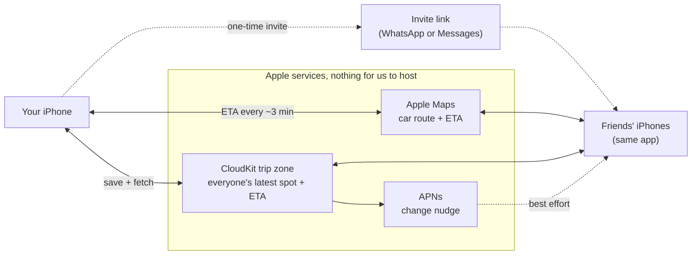
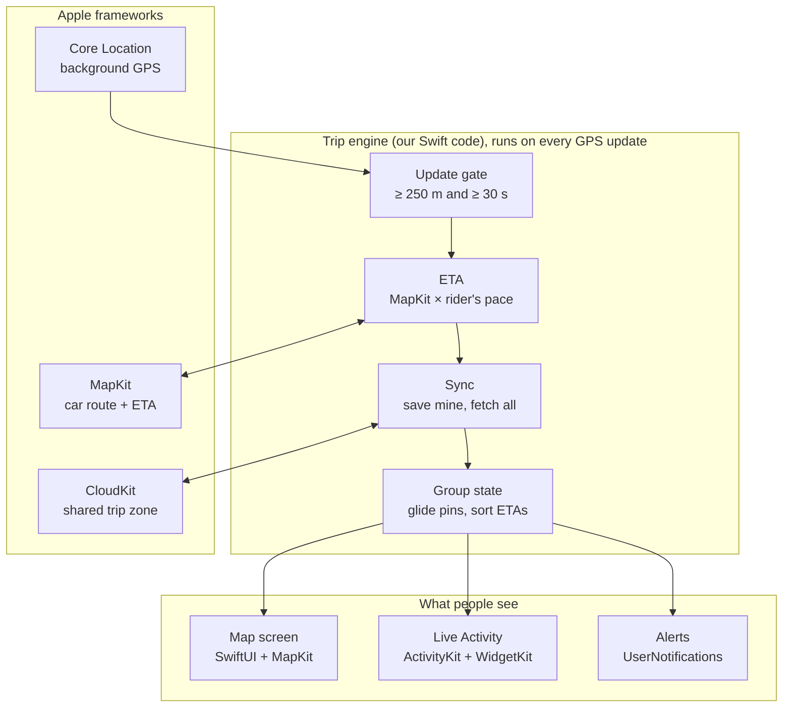

# Funtastic4

A road trip app for riding together. Everyone in the group sees where the others are on one map, along with each person's ETA to the destination. It's built for scooter groups in Bali, uses only Apple frameworks, and needs no server of our own.

> **Status:** design stage. The Xcode project is still the blank SwiftUI template; this README records the architecture we agreed on.

## How it works

- Everyone who joins the trip shares their own location and ETA. Anyone can pause sharing.
- Each phone saves its own position and ETA to a shared CloudKit trip zone and reads everyone else's from it.
- Friends join with an invite link sent over WhatsApp or Messages.
- Each phone works out only its own ETA: Apple Maps' car ETA, adjusted by the rider's real pace. It publishes an arrival time (14:32), not a countdown, so other phones count down on their own.

## System overview

## Inside the app

The trip engine is the only part we write ourselves. Everything around it is an Apple framework.

## Frameworks

| Framework | What it does here |
|---|---|
| SwiftUI | All screens |
| MapKit for SwiftUI | `Map`, a pin per member (`Annotation`), route line (`MapPolyline`) |
| MapKit | `MKDirections.calculateETA` for each rider's own ETA; `MKLocalSearch` for the destination and stops |
| Core Location | `CLLocationUpdate.liveUpdates()` for GPS; `CLBackgroundActivitySession` keeps it running with the screen off; `CLMonitor` detects arrival |
| CloudKit | Trip zone shared with `CKShare`; one record per member; `CKDatabaseSubscription` for change nudges; `encryptedValues` for coordinates |
| ActivityKit + WidgetKit | Live Activity with everyone's ETA on the Lock Screen and Dynamic Island, also shown on CarPlay (iOS 26) and in the Apple Watch Smart Stack |
| UserNotifications | Alerts like "Sam arrived" or "Made is 20 min behind" |

## Core logic

### When a phone sends its position

About once a second while moving, iOS hands the app a GPS reading. The app measures the straight-line distance from the last position it sent (`CLLocation.distance(from:)`) and sends only when both are true:

- the distance is at least 250 m
- at least 30 s have passed since the last send

Readings with an accuracy radius worse than about 50 m are skipped (tunnels, thick trees, indoors). Measuring from the last sent position, instead of adding up small steps, stops GPS wobble while parked from counting as movement. Nothing is sent while parked.

### ETA

1. Every ~3 min, or when the rider leaves the route, ask MapKit for a car ETA to the destination.
2. Adjust it by the rider's pace: compare how much MapKit's remaining time dropped with how much real time passed, skipping time spent stopped. Example: over 10 real minutes, MapKit's remaining time dropped by 14 minutes, so the pace is 1.4. A MapKit estimate of 26 min left becomes about 19 min.
3. Publish the arrival time, not the minutes left, so the figure never goes stale on other phones.

### Between updates

Each update carries speed and heading. Other phones move the pin forward smoothly until the next update arrives.

### Timing

| What | When |
|---|---|
| GPS | `liveUpdates` while moving; pauses itself when parked |
| Upload + fetch | After ≥ 250 m and ≥ 30 s; nothing while parked |
| ETA | Car route every ~3 min or when off-route, adjusted by pace |
| Extra fetches | Every ~15 s while the map is open, plus APNs nudges |
| Live Activity | Updated on the phone after each sync; restarted every 8 h |

## Data (CloudKit)

| Record | One per | Fields |
|---|---|---|
| `Trip` | group | name, destination, stops |
| `Member` | person | name, avatar, location (encrypted), speed, heading, arrival time, last update, status (moving / stopped / paused / arrived) |

A trip, step by step:

1. The host taps New trip. The app creates the trip zone, the `Trip` record, the host's `Member` record and a share link.
2. The host sends the link on WhatsApp. A friend taps it, and the app accepts the share.
3. Each phone saves only its own `Member` record, overwriting it each time, so no two phones edit the same record.
4. To see the others, the app fetches only what changed in the zone since its last check.
5. When the trip ends, the host deletes the zone and everyone's data is gone.

## Known limits

- iPhone only, and everyone needs an iCloud account.
- Positions refresh every ~30–45 s, not live; pins glide in between.
- A parked phone stops refreshing in the background until it moves or the app is opened.
- If someone swipes the app away, their sharing stops until they reopen it.
- MapKit has no motorcycle mode, so ETAs are car ETAs adjusted by each rider's pace.
- Apple doesn't list Indonesia for Maps traffic or turn-by-turn. MapKit ETAs in Bali still change with the time of day (Canggu to Ubud: 79 min leaving Monday 17:30, 49 min at 3 am) and seem to include current conditions.
- Live Activities end after 8 hours.

## Open decisions

- **Turn-by-turn navigation:** a Navigate button that opens Google Maps in motorcycle mode, or our own navigation screen built on MapKit.
- **Minimum iOS version:** 26.5 now (the Xcode default); the frameworks above work back to iOS 18.
- **Spoken updates** through helmet intercoms (AVFoundation): left out for now.
- **Google two-wheeler routing:** left out for now (paid, not Apple).

## Project setup

- Xcode 26.6, SwiftUI app template
- Bundle ID `com.hardy.Funtastic4`
- Minimum iOS 26.5

## License

MIT, see [LICENSE](LICENSE).
