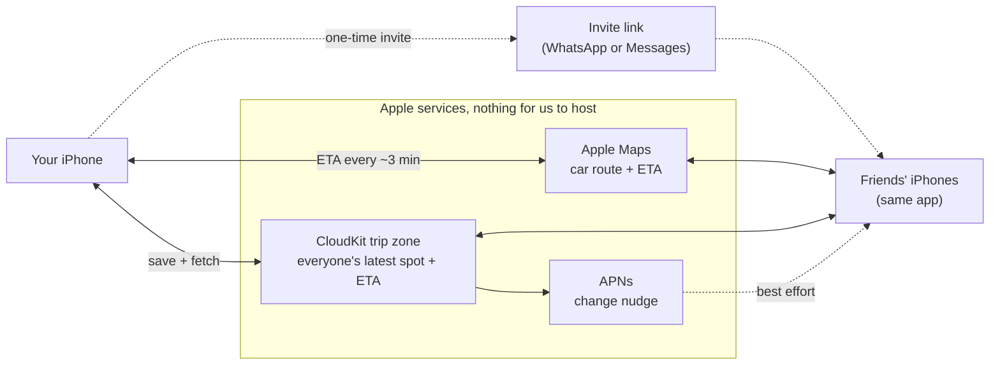
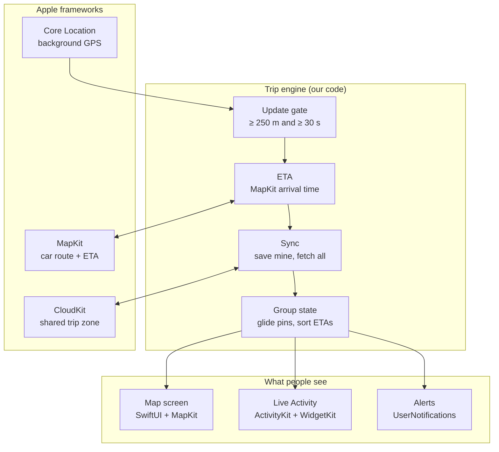
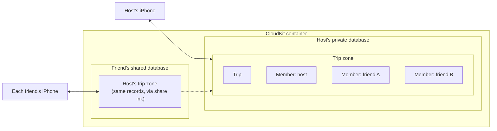

# Funtastic4

A road trip app for travelling together. Everyone in the group sees where the others are on one map, along with each person's ETA to the destination. It uses only Apple frameworks and needs no server of our own.

> **Status:** design stage. The Xcode project is still the blank SwiftUI template; this README records the architecture we agreed on.

## How it works

- Everyone who joins the trip shares their own location and ETA. Anyone can pause sharing.
- Each phone saves its own position and ETA to a shared CloudKit trip zone and reads everyone else's from it.
- Friends join with an invite link sent over WhatsApp or Messages.
- Each phone asks Apple Maps for its own ETA and publishes the arrival time Apple Maps returns (14:32), so other phones count down on their own.
- Sharing keeps running with the screen locked or while using other apps.

## System overview

## Inside the app

The trip engine is the only part we write ourselves, and it runs on every GPS update. Everything around it is an Apple framework.

## Frameworks

| Framework | What it does here |
|---|---|
| SwiftUI | All screens |
| MapKit for SwiftUI | `Map`, a pin per member (`Annotation`), route line (`MapPolyline`) |
| MapKit | `MKDirections.calculateETA` returns each rider's ETA and arrival time; `MKLocalSearch` finds the destination and stops |
| Core Location | `CLLocationUpdate.liveUpdates()` for GPS; `CLBackgroundActivitySession` keeps it running with the screen locked or in other apps; `CLMonitor` detects arrival |
| CloudKit | Trip zone shared with `CKShare`; one record per member; `CKDatabaseSubscription` for change nudges; `encryptedValues` for coordinates |
| ActivityKit + WidgetKit | Live Activity with everyone's ETA on the Lock Screen and Dynamic Island, also shown on CarPlay (iOS 26) and in the Apple Watch Smart Stack |
| UserNotifications | Alerts like "Sam arrived" or "Made is 20 min behind", and the "sharing stopped" reminder |

## Core logic

### When a phone sends its position

About once a second while moving, iOS hands the app a GPS reading. The app measures the straight-line distance from the last position it sent (`CLLocation.distance(from:)`) and sends only when both are true:

- the distance is at least 250 m
- at least 30 s have passed since the last send

Readings with an accuracy radius worse than about 50 m are skipped (tunnels, thick trees, indoors). Measuring from the last sent position, instead of adding up small steps, stops GPS wobble while parked from counting as movement. Nothing is sent while parked.

### ETA

MapKit does the whole ETA calculation on Apple's servers; the app doesn't compute ETAs itself. Every ~3 min, or when the rider leaves the route, the app calls `MKDirections.calculateETA` and publishes the `expectedArrivalDate` it returns. Other phones count down from that time, so the figure never goes stale.

Each phone asks only for its own ETA, so a group of N people makes N requests, not N².

### Between updates

Each update carries speed and heading. Other phones move the pin forward smoothly until the next update arrives.

### Timing

| What | When |
|---|---|
| GPS | `liveUpdates` while moving; pauses itself when parked |
| Upload + fetch | After ≥ 250 m and ≥ 30 s; nothing while parked |
| ETA | MapKit ETA every ~3 min or when off-route |
| Extra fetches | Every ~15 s while the map is open, plus APNs nudges |
| Live Activity | Updated on the phone after each sync; restarted every 8 h |

## Running in the background

| Situation | What happens |
|---|---|
| Screen locked | Keeps sharing. The background location session keeps GPS running, and the blue location indicator shows it. |
| Using another app (for example, navigating in Google Maps) | Keeps sharing, same as above. |
| Parked | iOS pauses GPS to save battery and resumes it when the phone moves. |
| App swiped away (force-quit) | iOS stops the app on purpose and doesn't restart it until the rider opens it again. |

Because a swiped-away app can't keep sharing, we make it visible instead:

- The rider's Live Activity marks itself stale (ActivityKit `staleDate`) and shows "Sharing stopped, open Funtastic4 to resume".
- A reminder notification fires if updates stop while the rider is moving. Each send pushes a scheduled local notification ~5 min into the future, and parking cancels it, so it only goes off when sending stops unexpectedly.
- Friends see "Not updating · last seen 14:05" once the rider's last update is a few minutes old.

Relaunching a swiped-away app through significant-location-change monitoring isn't used. Apple describes that relaunch as off-label, and developers report it no longer relaunches force-quit apps on iOS 26.

## Battery estimates

These are rough estimates, not measurements. They assume a recent iPhone (~13–14 Wh battery), the screen off, decent mobile signal, and ~3–6 J of radio energy per upload. Measure on a real ride with Instruments' Power Profiler (iOS 26 or later) before tuning.

| Option | Uploads per hour (at 40 / 100 km/h) | Estimated drain per hour | 4-hour ride |
|---|---|---|---|
| Upload every 50 m | ~800 / ~2,000 | ~4–8% | ~16–32% |
| Upload every 10–15 s | 240–360 | ~3–7% | ~12–28% |
| **≥ 250 m and ≥ 30 s (chosen)** | ~120 / ~120 | **~2–4%** | **~8–16%** |
| Parked (any option) | 0 | under 0.5% | — |
| Map open on screen | — | +10–20% | — |
| Navigating, in Google Maps or our own screen | — | ~10–20% | ~40–80% |

Where the energy goes:

- **GPS while moving:** ~1–3% per hour. If the rider is already navigating, GPS is on anyway, so our app adds almost nothing here.
- **Mobile radio:** each upload keeps the radio powered for several seconds afterwards. Uploads less than ~10–15 s apart keep it on permanently, which is why the number of uploads matters more than their size.
- **ETA requests, Live Activity updates and the update gate:** well under 1% per hour together.
- **Screen:** by far the biggest cost. An open map or navigation screen outweighs everything above.

## Data (CloudKit)

| Record | One per | Fields |
|---|---|---|
| `Trip` | group | name, destination, stops |
| `Member` | person | name, avatar, location (encrypted), speed, heading, arrival time, last update, status (moving / stopped / paused / arrived) |

A trip, step by step:

1. The host taps New trip. The app creates the trip zone, the `Trip` record, the host's `Member` record and a share link.
2. The host sends the link on WhatsApp. A friend taps it, and the app accepts the share.
3. Each phone saves only its own `Member` record, overwriting it each time, so no two phones edit the same record.
4. To see the others, the app fetches only what changed in the zone since its last check.
5. When the trip ends, the host deletes the zone and everyone's data is gone.

## Known limits

- iPhone only, and everyone needs an iCloud account.
- Positions refresh every ~30–45 s while moving, not live; pins glide in between.
- A parked phone stops refreshing in the background until it moves or the app is opened.
- A swiped-away app stops sharing until it's reopened (see [Running in the background](#running-in-the-background)).
- MapKit has no motorcycle mode, so motorbike ETAs use car routes.
- How much live traffic MapKit's ETAs include depends on Apple's coverage in each country.
- Live Activities end after 8 hours.

## Open decisions

- **Turn-by-turn navigation:** a Navigate button that opens Google Maps in motorcycle mode, or our own navigation screen built on MapKit.
- **Motorbike ETA adjustment:** only if MapKit's car ETAs prove consistently off in testing.
- **Minimum iOS version:** 26.5 now (the Xcode default); the frameworks above work back to iOS 18.
- **Spoken updates** through helmet intercoms (AVFoundation): left out for now.
- **Google two-wheeler routing:** left out for now (paid, not Apple).

## Project setup

- Xcode 26.6, SwiftUI app template
- Bundle ID `com.hardy.Funtastic4`
- Minimum iOS 26.5

## License

MIT, see [LICENSE](LICENSE).
